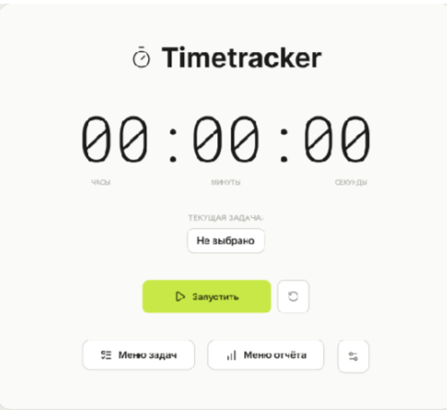
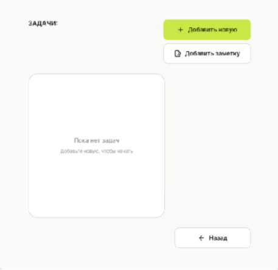

# 1 Экран (Главное меню)
## Назначение: Является начальной точкой, куда пользователь попадает при запуске приложения, на этом экране находиться сам таймер
## Элементы управления: 
### Кнопка запуска - запускает сам таймер
### Кнопка "меню задач" - переводит на другой экран с задачами
### Кнопка "Меню отчетов" - переводит на другой экран с отчетами
### Кнопка сброса рядом с кнопкой запуска - сбрасывает таймер
### Кнопка настроек рядом с кнопкой "меню отчетов" - открывает меню с настройками
## Данные, отображаемые на экране:
### Текущая задача - берется из task_id, текстовый формат
### Таймер - берется из timer_id, числовой формат
## Действия пользователя:
### Пользователь может перейти на другие меню с помощью кнопок "меню отчетов" и "меню задач"
### Пользователь может сбросить таймер
### Пользователь может открыть настройки
## Реакция системы:
### После нажатия кнопок "меню задач", "меню отчетов" и "настройки" система переводит пользователя на другие экраны
### После нажатия на кнопку сброса, происходит обновление данных timer_id и start_time
## Обработка ошибок:
### При попытке сбросить пустой таймер, всплывает сообщение "нету действующего таймера"
### При попытке запустить таймер без задачи выдаст предупреждение " задача не выбрана"

# 2 Экран (Меню задач)
## Назначение: Экран где хранится список всех существующих задач, в этом экране создаются задачи и заметки к задачам
## Элементы управления: 
### Кнопка "добавить новую" - открывает окошка для создания новой задачи
### Кнопка "добавить заметку" - открывает окошка для добавления заметки к задаче
### Кнопка "назад" - возвращает на главное меню
### Список задач - окошко где пользователь может выбрать нужную задачу, отредактировать её, или удалить
## Данные, отображаемые на экране:
### Задачи в списке берутся из task_id, текстовый формат
### Заметки берутся из note_id, текстовый формат
## Действия пользователя:
### Пользователь может добавить новую задачу, отредактировать его в списке задачи, или удалить
### Пользователь может добавить новую метку к задаче, отредактировать его или удалить
### Пользователь может вернуться в главное меню
## Реакция системы:
### После того, как пользователь создал новую задачу, система создает новую task_id, и выводит задачу в список
### После того, как пользователь создал новую заметку, система создает новую note_id, и прикрепляет его к выбранной задаче
### После того, как пользователь нажимает кнопку "назад" система возвращает его на главное меню
### После того, как пользователь отредактировал задачу (поменял название, или длительность задачи) система перезаписывает task_id
### После того, как пользователь удалил задачу, система стирает данные task_id
### Если пользователь попытается удалить задачу, система спросит подтверждение
## Обработка ошибок:
### Если пользователь попытается создать задачу, с пустым названием, система выдаст ошибку
### Если пользователь попытается создать пустую заметку, система выдаст ошибку
### Если пользователь попытается создать таймер для задачи с отрицательным значением, система выдаст ошибку
